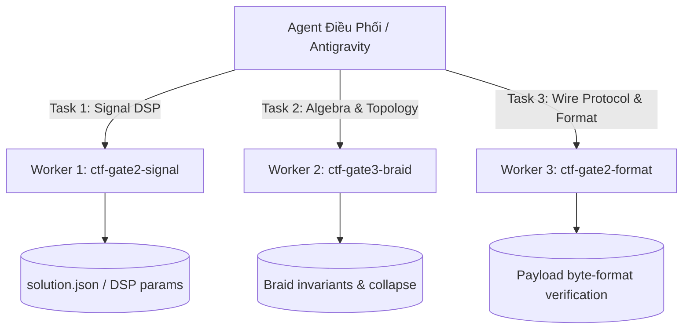

# Using GPT-CLI as Autonomous Subagents

Runtime hướng dẫn khai thác tối đa năng lực của **`gpt-cli`** (`/home/light/.local/bin/gpt`) — client ChatGPT Web Wire Conduit siêu tốc (0 MB browser RAM), lock cứng model flagship **`gpt-5-6-thinking`** (`thinking_effort="extended"`), tự giải PoW SHA3-512 nội bộ.

---

## 1. Quick Reference: Các Lệnh Thực Chiến Hàng Ngày

| Tác vụ | Lệnh CLI | Mục đích & Ngữ cảnh |
|---|---|---|
| **Hỏi nhanh (Zero-shot)** | `gpt "Giải thích ngắn gọn thuật toán X"` | Trả lời nhanh một turn, stream thẳng ra terminal |
| **Chạy turn xuất JSON** | `gpt run -p "Prompt cho agent" --json` | Dành cho agent parse output JSON có cấu trúc |
| **Kích hoạt Subagent Tự Trị** | `gpt run -t "subagent-tag" -b br -p "solve <ABSOLUTE_PATH> <TASK>" --json` | Giao task cho `gpt` tự đọc file, viết code, chạy lệnh trong workspace |
| **Tiếp tục Session cũ** | `gpt run --resume-session <ID> -b br -p "solve <ABSOLUTE_PATH> <NEXT_TASK>" --json` | Giữ nguyên ngữ cảnh và cây DAG hội thoại của subagent |
| **Tạo Session mới có tag** | `gpt run --new -t "ctf-worker-dsp" -p "..." --json` | Khởi tạo thread mới, tránh lẫn lộn context cũ |
| **Liệt kê Session** | `gpt session list` (hoặc `gpt session list --json`) | Xem danh sách session, số turns, tag, thời gian |
| **Đọc transcript session** | `gpt session log <ID>` | Xem toàn bộ prompt, response text, thinking duration |
| **Đọc N turns cuối** | `gpt session log <ID> --tail 2` | Kiểm tra nhanh kết quả của lượt chạy gần nhất |
| **Xem telemetry events** | `gpt session log <ID> --events` | Soi chi tiết SSE frames, thoughts, web queries, tool calls |
| **Xóa session rác** | `gpt session delete <ID>` | Dọn dẹp session sau khi hoàn thành |
| **Quản lý Gateway nền** | `systemctl --user status webgpt-gateway.service` | Giám sát micro gateway ASGI (Port 18000) |

---

## 2. Bản Chất & Thế Mạnh Của `gpt-5-6-thinking`

`gpt-cli` kết nối trực tiếp tới model **`gpt-5-6-thinking`** với `thinking_effort="extended"`:
- **Khả năng tư duy toán học chuyên sâu:** Xuất sắc trong việc giải quyết các bài toán trừu tượng: Topology (Braid Groups $B_n$, knot invariants, Garside normal form), Mật mã học (Lattice, RSA, ECC, ZKP), Xử lý tín hiệu số (Spectral estimation, Coherent phase search, Chirp trajectory modeling).
- **Khả năng Search Web thời gian thực:** Tự động tìm kiếm tài liệu học thuật, RFC, papers mới nhất để giải bài.
- **Khả năng dùng công cụ (Tool Use):** Khi kết nối bridge (`-b br`), model có thể thao tác với file hệ thống và thực thi bash commands độc lập.
- **Tài khoản không bao giờ hết quota thông thường:** Lỗi `401 Unauthorized` hoặc `403 Forbidden` **99% là lỗi logic giao thức wire** (cookie, headers, PoW, Sentinel hash), tuyệt đối không phán bừa là "hết token".

---

## 3. Cơ Chế Subagent Tự Trị Qua Bridge (`-b br`)

Khi gặp bài toán phức tạp đòi hỏi vừa đọc dữ liệu, vừa viết code giải, vừa chạy thử nghiệm và kiểm chứng kết quả: **Đừng chỉ hỏi text thuần túy. Hãy triệu hồi `gpt` như một Subagent Tự Trị!**

### 3.1. Cú pháp triệu hồi chuẩn

```bash
gpt run -t "<tag-mô-tả>" -b br -p "solve <ĐƯỜNG_DẪN_TUYỆT_ĐỐI_WORKSPACE> <YÊU_CẦU_CHI_TIẾT>" --json
```

### 3.2. Cơ chế vận hành nội bộ của Bridge:
1. Cờ `-b br` kích hoạt đầu nối Workspace Bridge (BQA connector).
2. Khi prompt mở đầu bằng `solve <path>`, bridge tự động gắn subagent vào workspace qua lệnh `host_workspace_bind`.
3. Subagent được trang bị các tool hệ thống của host:
   - `host_read_file`: Đọc đề bài (`TASK.md`), dữ liệu mẫu (`instance.json`).
   - `host_run_command` / `container.exec`: Viết script solver, chạy lệnh bash, chạy unit test.
   - `host_search_text`: Tìm kiếm chuỗi/pattern trong thư mục workspace.
   - `host_write_file`: Lưu lời giải vào `solution.json` hoặc báo cáo `analysis_report.md`.

---

## 4. Multi-Agent Concurrency: Phối Hợp Tối Đa 3 GPT Subagents Song Song

Hệ thống cho phép chạy **tối đa 3 subagents `gpt-cli` đồng thời** mà không gây nghẽn kết nối.

### 4.1. Phân rã bài toán đa chiều (Separation of Concerns)

Thay vì nhồi nhét mọi thứ vào 1 prompt duy nhất, hãy chia nhỏ bài toán thành 3 khía cạnh độc lập và giao cho 3 worker:



### 4.2. Kịch bản khởi chạy 3 Workers:

```bash
# Worker 1: Chuyên trách mô hình hóa tín hiệu & tìm tần số biên
gpt run -t "ctf-worker-signal" -b br -p "solve /home/light/Downloads/ctf_test_task/math_workspace Đọc /home/light/Downloads/ctf_test_task/math_workspace/TASK.md và instance.json. Tập trung phân tích phổ STFT, trích xuất tham số chirp f(t) = f0 + k*t^2, tối ưu hóa lưới pha coherent grid search và ghi vào solution.json." --json &

# Worker 2: Chuyên trách cấu trúc topo đại số & nhóm Braid
gpt run -t "ctf-worker-braid" -b br -p "solve /home/light/Downloads/ctf_test_task/math_workspace Đọc /home/light/Downloads/ctf_test_task/math_workspace/TASK.md. Tập trung giải quyết Gate 3: Nhóm Braid B_n, Artin generators, Garside normal form, Kauffman bracket skein relations, và invariant để collapse singularity." --json &

# Worker 3: Chuyên trách giải mã giao thức & định dạng payload
gpt run -t "ctf-worker-protocol" -b br -p "solve /home/light/Downloads/ctf_test_task/math_workspace Đọc /home/light/Downloads/ctf_test_task/math_workspace/TASK.md. Tập trung rà soát các định dạng wire encoding cho f_bounds (be16, le16, be32, le32, float, hex-encoded ASCII, binary words) và viết script test định dạng." --json &
```

---

## 5. Những "Tâm Đắc Thực Chiến" Cốt Lõi (Hard-Earned Lessons)

### 🌟 Tâm Đắc 1: Luôn Dùng Absolute Path và Chỉ Thị Dùng Host MCP Tools Trong Prompt
- **Hiện tượng:** Khi prompt viết `solve /workspace "Hãy đọc TASK.md"`, subagent có thể chạy mặc định `container.exec` (môi trường cloud container của OpenAI) và bị lỗi `No such file or directory` vì files nằm trên máy chủ host (`/home/light/...`).
- **Quy tắc vàng:**
  1. **BẮT BUỘC ghi rõ đường dẫn tuyệt đối cho mọi file quan trọng** ngay trong câu lệnh prompt:
     `Please read /home/light/Downloads/ctf_test_task/math_workspace/TASK.md`
  2. **BẮT BUỘC chỉ thị dùng tool của host:** Thêm câu:
     `"Use the @br host tools (host_read_file, host_run_command, host_write_file) to inspect and execute files directly on the host machine. Do NOT use container.exec."`

### 🌟 Tâm Đắc 2: Tránh Bẫy "Echo Cache / Premature Done"
- **Hiện tượng:** Nếu workspace đã có sẵn file `solution.json` cũ từ lượt trước, subagent khi được gọi có thể chỉ đọc lướt qua file `solution.json` cũ, thấy `"status": "solved"` rồi vội vàng kết luận *"Nhiệm vụ đã hoàn thành từ trước"* mà không thực sự chạy tính toán lại với dữ liệu mới!
- **Giải pháp:**
  1. Xóa hoặc đổi tên file output cũ (`mv solution.json solution_prev.json`) trước khi giao task mới.
  2. Thêm chỉ thị dứt khoát trong prompt: *"File solution.json hiện có là dữ liệu cũ. Bạn BẮT BUỘC phải đọc instance.json mới, tự chạy analyze_and_solve.py để sinh lại kết quả mới và ghi đè lên solution.json."*

### 🌟 Tâm Đắc 3: Xử Lý Khi Subagent "Giải Xong Cực Nhanh" (< 15-20s)
- **Hiện tượng:** Với `gpt-5-6-thinking`, khi gặp bài toán khó mà subagent trả lời cực nhanh (< 15s) thường là **bất thường (Anomaly)**:
  1. *Subagent hiểu nhầm là câu hỏi lý thuyết:* Trả lời dạng text thuần túy mà không gọi tool.
  2. *Lỗi đường dẫn / môi trường:* Tool đầu tiên báo lỗi (`No such file or directory`), subagent dừng ngay lập tức.
  3. *CoT chưa kích hoạt:* Yêu cầu prepare thiếu `thinking_effort: "extended"` (đã được fix tại `gpt_cli/transport/conduit.py` và `wire.py`).
- **Giải pháp:** Kiểm tra telemetry ngay bằng `gpt session log <ID> --events`. Nếu thấy thiếu tool calls hoặc lỗi CWD, tái điều khiển bằng prompt dứt khoát chỉ định tool `host_read_file` / `host_run_command`.

### 🌟 Tâm Đắc 4: Giữ Gìn Vệ Sinh Output Của Tool (Tool Output Hygiene)
- **Hiện tượng:** Lệnh bash in ra hàng chục nghìn dòng (ví dụ dump hex PCM audio 64KB trực tiếp ra stdout) sẽ làm nổ context window và khiến turn tiếp theo bị nghẽn.
- **Quy tắc:** Subagent phải luôn redirect dữ liệu lớn vào file hoặc lọc qua pipe (`head -n 20`, `wc -l`, `summary statistics`), chỉ in tóm tắt kết quả ra màn hình.

### 🌟 Tâm Đắc 5: Quản Lý Cây DAG & Tính Liên Tục Của Session
- `gpt-cli` sử dụng cơ chế Server-Side DAG (`conversation_id`, `parent_message_id`), client chỉ gửi tin nhắn mới nhất chứ không gửi lại toàn bộ lịch sử 50 turns.
- Khi muốn subagent tiếp tục đào sâu một vấn đề mà không phải giải thích lại bối cảnh từ đầu, hãy dùng cờ `--resume-session <session_id>`:
  ```bash
  gpt run --resume-session sess_6260afbc -b br -p "Kết quả ban đầu f0=1536 tốt, giờ hãy kiểm tra thêm trường hợp tần số âm." --json
  ```

### 🌟 Tâm Đắc 6: Nguyên Tắc Cô Lập Không Gian Thử Nghiệm (`~/Downloads/`)
- Mọi script thử nghiệm tạm thời, dữ liệu cào, file âm thanh raw, math workspace BẮT BUỘC tạo bên trong thư mục cô lập `~/Downloads/<task_name>/`.
- Tuyệt đối không tạo file rác trong root repository (`/home/light/GitHub/gpt_cli` hoặc `/home/light/Workspace/...`) để giữ sạch `git status`.

---

## 6. Bảng Tra Cứu Xử Lý Lỗi (Troubleshooting Table)

| Triệu chứng | Nguyên nhân gốc rễ | Hành động khắc phục |
|---|---|---|
| `HTTP 401 Unauthorized` hoặc `HTTP 403 Forbidden` | Sai định dạng cookie, lệch header `ChatGPT-Account-ID`, hash Sentinel lỗi thời, hoặc User-Agent lệch với TLS fingerprint | **Không phán hết token.** Kiểm tra file `gpt_cli/transport/conduit.py`, kiểm tra JWT token expiry, in raw headers để đối soát. |
| `ls: cannot access ...: No such file or directory` | Subagent dùng nhầm `container.exec` của cloud thay vì `@br` host tools | Chỉ thị rõ trong prompt: *"Use @br host tools (host_read_file, host_run_command, host_write_file) to access the host files."* |
| Subagent trả lời ngay "Task already solved" | Subagent thấy file `solution.json` cũ có sẵn trong workspace | Xóa/đổi tên file output cũ hoặc thêm lệnh ép buộc re-calculate từ `instance.json`. |
| Subagent trả về cực nhanh mà không tính toán | Thiếu CoT extended hoặc model coi prompt là câu hỏi text | Kiểm tra cờ `--effort extended`, dùng prompt chỉ thị hành động rõ ràng và chỉ định tool cần chạy. |
| Kết nối `f_bounds` trên server CTF đóng socket ngay (`b''`) | Dữ liệu tính toán bị lệch do cửa sổ STFT không bù trừ biên, hoặc sai định dạng wire encoding | Mở rộng lưới tìm kiếm coherent phase grid search, test nhiều định dạng đóng gói (`struct.pack('>HH', ...)`). |
| Server trả về rỗng hoặc ngắt kết nối giữa chừng | Stream bị ngắt hoặc parser bắt nhầm frame context trung gian | Sử dụng `gpt session log <id> --events` để soi frame SSE. Kiểm tra `COMPLETION_STATUSES` trong parser. |

---

## 7. Mẫu Dispatch Subagent Chuẩn (Production Template)

Dành cho các AI Agent (Antigravity, Codex, etc.) khi cần dispatch `gpt-cli` subagent:

```bash
# 1. Khởi tạo workspace cô lập
mkdir -p /home/light/Downloads/ctf_test_<challenge>/math_workspace
cd /home/light/Downloads/ctf_test_<challenge>/math_workspace

# 2. Ghi đề bài TASK.md và dữ liệu instance.json (Tier 3 Math Isolation)
# ...

# 3. Kích hoạt subagent tự trị gpt-5-6-thinking
gpt run -t "subagent-math-solver" -b br \
  -p "solve /home/light/Downloads/ctf_test_<challenge>/math_workspace Please read /home/light/Downloads/ctf_test_<challenge>/math_workspace/TASK.md and /home/light/Downloads/ctf_test_<challenge>/math_workspace/instance.json. Follow all instructions in TASK.md to perform high-resolution spectral estimation, write and execute analyze_and_solve.py, and produce solution.json." \
  --json

# 4. Kiểm tra kết quả
cat /home/light/Downloads/ctf_test_<challenge>/math_workspace/solution.json
```
